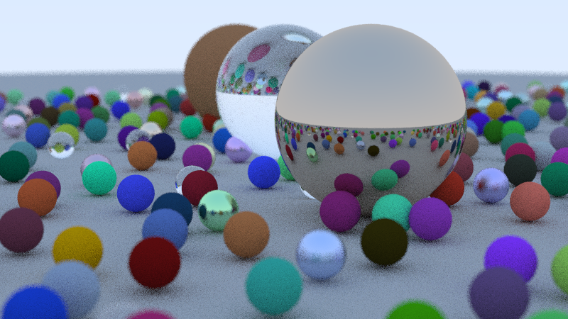

# Simple Ray Tracer

A CPU-based ray tracer written in C++17, built by following the
[_Ray Tracing in One Weekend_](https://raytracing.github.io/books/RayTracingInOneWeekend.html)
book series.

It produces a `.ppm` image by simulating how light rays interact with a scene
of spheres, supporting diffuse, metallic, and dielectric (glass) materials with
realistic defocus blur and depth of field.

---

## Output

The renderer writes a PPM image to stdout. The included `image.ppm` is a
1920 x 1080 render at 500 samples per pixel with 50 bounce depth.

---
## Render Preview



## Features

- **Materials**
  - Lambertian (diffuse) — matte surfaces with randomised scatter
  - Metal — reflective surfaces with configurable fuzz
  - Dielectric (glass) — refraction via Snell's law + Schlick approximation
- **Camera**
  - Configurable field of view, look-from/look-at, and up vector
  - Defocus blur / depth of field
- **Anti-aliasing** — multi-sample averaging per pixel
- **Gamma correction** — linear-to-gamma transform (gamma 2)
- **Recursive ray bouncing** — configurable max depth

---

## Project Structure

```
Simple Ray Tracer/
|
|-- main.cc                     # Entry point: scene setup and render call
|-- CMakeLists.txt              # Build configuration
|-- image.ppm                   # Sample output image
|
|-- headers/                    # All header files
|   |-- rtweekend.h             # Global constants, utilities, and common includes
|   |-- vec3.h                  # 3D vector class and math (dot, cross, reflect, refract)
|   |-- ray.h                   # Ray class: P(t) = origin + t * direction
|   |-- color.h                 # Color alias, gamma correction, PPM output
|   |-- interval.h              # Scalar interval with clamp/contains/surrounds
|   |-- hittable.h              # Abstract hittable interface and hit_record
|   |-- hittable_list.h         # Scene container (list of hittables)
|   |-- sphere.h                # Sphere geometry implementing hittable
|   |-- material.h              # Material base class + lambertian, metal, dielectric
|   `-- camera.h                # Camera setup, ray generation, and render loop
|
|-- creating_image.cpp          # Early learning snippet: basic PPM image output
|-- image_setup_snippets.cpp    # Early learning snippet: viewport setup
|
`-- Learning Part/              # Standalone C++ concept explorations
    |-- operator_overloading.cpp
    |-- sharedptr_vector.cpp
    |-- vec3_class.cpp
    `-- op_overload              # Compiled binary
```

---

## Dependencies

- C++17 or later
- CMake 3.20 or later (for CMake build)
- Any standard C++ compiler — `g++`, `clang++`, MSVC

No third-party libraries are used.

---

## Building and Running

### Using CMake

```bash
mkdir build && cd build
cmake ..
cmake --build .
./SimpleRayTracer > image.ppm
```

### Using g++ directly

```bash
g++ -std=c++17 -O2 -I. main.cc -o raytracer
./raytracer > image.ppm
```

The `-I.` flag is needed so the compiler resolves `headers/` relative to the
project root.

Rendering at full settings (1920 px, 500 samples) takes several minutes on a
single CPU core. Reduce `image_width` and `samples_per_pixel` in `main.cc` for
faster iteration.

---

## Viewing the Output

PPM is a plain-text image format. Open `image.ppm` with:

- **Linux** — `eog image.ppm`, `feh image.ppm`, or GIMP
- **macOS** — Preview opens PPM natively
- **Windows** — Use GIMP, IrfanView, or convert via ImageMagick:
  ```bash
  magick image.ppm image.png
  ```

---

## Architecture Overview

The include chain is intentionally layered to avoid circular dependencies:

```
rtweekend.h
  |-- vec3.h
  |-- ray.h       (depends on vec3.h)
  |-- color.h     (depends on vec3.h, interval.h)
  `-- interval.h

hittable.h        (depends on ray.h)
hittable_list.h   (depends on hittable.h)
sphere.h          (depends on hittable.h, vec3.h)
material.h        (depends on hittable.h)
camera.h          (depends on hittable.h, material.h)
```

`main.cc` sits at the top and pulls everything together through `rtweekend.h`
plus the scene-level headers.

---

## Configuring the Scene

All render parameters are set directly in `main.cc`:

| Parameter | What it controls |
|---|---|
| `cam.image_width` | Horizontal resolution in pixels |
| `cam.aspect_ratio` | Width / height ratio |
| `cam.samples_per_pixel` | Anti-aliasing quality (higher = slower, less noise) |
| `cam.max_depth` | Max ray bounces per path |
| `cam.vfov` | Vertical field of view in degrees |
| `cam.lookfrom` / `cam.lookat` | Camera position and target |
| `cam.defocus_angle` | Aperture size (0 = pinhole, no blur) |
| `cam.focus_dist` | Distance to the plane of sharp focus |

---

## Reference

- [_Ray Tracing in One Weekend_](https://raytracing.github.io/books/RayTracingInOneWeekend.html) by Peter Shirley, Trevor David Black, Steve Hollasch
